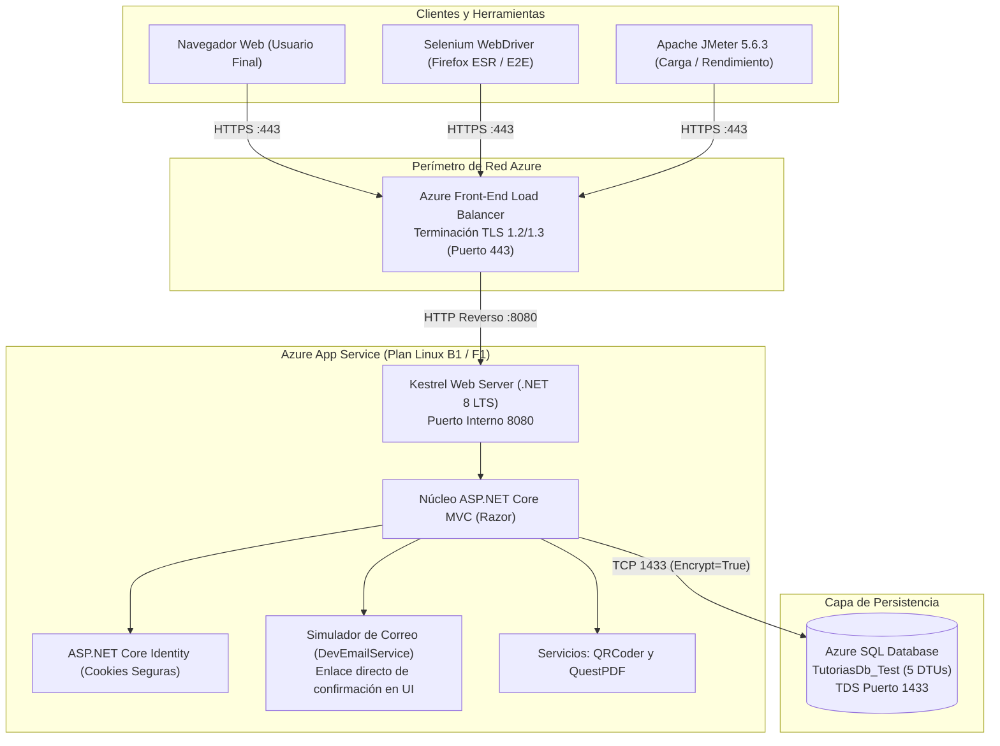

# Especificación del Ambiente de Pruebas en Microsoft Azure

**Proyecto:** Sistema Web de Gestión y Visibilidad de Tutorías Académicas de UPIICSA  
**Documento:** Configuración y Despliegue de Infraestructura Cloud para Pruebas (Staging)  
**Fecha:** 18 de noviembre de 2026  
**Destinatario:** Supervisión Técnica y Coordinación del Proyecto  

---

## 1. Propósito

Definir la arquitectura, especificaciones de infraestructura, variables de configuración, procedimiento de despliegue y plan de contingencia del ambiente de pruebas en Microsoft Azure para la validación funcional (Selenium WebDriver) y no funcional (Apache JMeter) del Sistema de Tutorías de UPIICSA.

---

## 2. Contexto del Ambiente

### 2.1 Objetivo del Ambiente
Proveer una plataforma de preproducción (*Staging / Testing-in-Production*) desacoplada del entorno local, con persistencia administrada en la nube y terminación TLS para:
- Ejecutar la suite automatizada de pruebas funcionales y de interfaz de usuario de extremo a extremo (E2E).
- Ejecutar pruebas no funcionales de carga, concurrencia y tiempo de respuesta sobre Kestrel y Azure SQL.
- Validar el flujo de registro institucional mediante el simulador interno de correo (`DevEmailService`) habilitado a través de la variable `ASPNETCORE_ENVIRONMENT=Development`, permitiendo la activación inmediata de cuentas de prueba mediante enlace visual en pantalla sin requerir dependencias de servicios externos de mensajería.
- Homologar el comportamiento de la solución previo al paso a producción.

### 2.2 Fase y Disciplina RUP
- **Fase RUP:** Transición (*Transition*). El producto cuenta con madurez funcional en la línea base de arquitectura y se evalúa en un entorno de ejecución análogo a producción.
- **Disciplinas RUP:**
  - *Pruebas (Test):* Ejecución determinista de casos de prueba automatizados en UI (Selenium) y rendimiento bajo estrés concurrente (JMeter).
  - *Despliegue (Deployment):* Generación del artefacto Release, aprovisionamiento de recursos PaaS, ejecución de migraciones de base de datos y validación de disponibilidad operativa.

### 2.3 Ambientes del Proyecto

| Parámetro | Ambiente Local (Desarrollo) | Ambiente Azure (Pruebas / Staging) |
| :--- | :--- | :--- |
| **Hospedaje** | Servidor Kestrel local (`localhost:5178`) | Azure App Service Linux (Contenedor Kestrel) |
| **Base de Datos** | Microsoft SQL Server (Docker / LocalDB) | Azure SQL Database v12.0 (Nivel Básico, 5 DTUs) |
| **Canal y Cifrado** | HTTP plano sin cifrado | HTTPS obligatorio (TLS 1.2 / 1.3 administrado) |
| **Modo de Ejecución** | `Development` | `Development` (para simulación de correo y depuración) |
| **Servicio de Correo** | Simulación en consola (`DevEmailService`) | Simulación activa (`DevEmailService`) con enlace directo en pantalla |
| **URL de Acceso** | `http://localhost:5178` | `https://app-tutorias-upiicsa-hcbccyhgbmccckdr.mexicocentral-01.azurewebsites.net` |

---

## 3. Arquitectura del Ambiente (Vista de Despliegue)

### 3.1 Diagrama de Despliegue



### 3.2 Flujo de Comunicación
1. El tráfico entrante (usuarios, Selenium y JMeter) ingresa por el puerto TCP 443 encriptado mediante TLS.
2. El balanceador frontal de Azure valida el certificado comodín de `azurewebsites.net`, descarga la capa TLS y enruta la petición al puerto interno `8080` de Kestrel.
3. Kestrel procesa la solicitud, gestiona la autenticación mediante cookies cifradas de ASP.NET Core Identity y ejecuta la lógica de negocio.
4. El acceso a datos se realiza a través de Entity Framework Core mediante el puerto TCP 1433 hacia Azure SQL con cifrado obligatorio (*Encrypt=True*).
5. Al registrar un nuevo usuario institucional, el sistema opera bajo `ASPNETCORE_ENVIRONMENT=Development`, activando `DevEmailService`. Esto genera e inyecta el token de confirmación directamente en la vista `RegisterConfirmation`, permitiendo verificar cuentas de prueba de forma inmediata sin requerir servicios externos de correo.

---

## 4. Configuración de la Infraestructura en Azure

### 4.1 Suscripción y Grupo de Recursos
- **Suscripción:** Azure for Students (identificador académico).
- **Grupo de Recursos:** `rg-tutorias-testing`
- **Región:** `mexicocentral` (Central de México)

### 4.2 Plan de App Service
- **Nombre:** `asp-tutorias-linux-plan`
- **Sistema Operativo:** Linux
- **Nivel de Precios:** Básico `B1` (1 Core, 1.75 GB RAM) / Nivel Gratuito `F1` (60 min CPU/día)
- **Región:** `mexicocentral`

### 4.3 App Service
- **Nombre del Recurso:** `app-tutorias-upiicsa-hcbccyhgbmccckdr`
- **FQDN / URL Pública:** `https://app-tutorias-upiicsa-hcbccyhgbmccckdr.mexicocentral-01.azurewebsites.net`
- **Pila de Runtime:** .NET 8 (LTS)
- **Redirección HTTPS:** Habilitada de forma estricta (*HTTPS Only = Enabled*). Puerto HTTP 80 redirige con código HTTP 301.

### 4.4 Azure SQL Database
- **Servidor Lógico:** `sqlserver-tutorias-testing.database.windows.net`
- **Base de Datos:** `TutoriasDb_Test`
- **Nivel de Cómputo:** Básico (*Basic Tier*), 5 DTUs, cuota máxima de 2 GB.
- **Autenticación:** SQL Server Authentication (usuario administrador: `tutoriasadmin`).
- **Reglas de Firewall:**
  - *Permitir servicios de Azure:* Habilitado (*Allow Azure services and resources to access this server = ON*).
  - *Regla de IP del Desarrollador:* Habilitada temporalmente para administración vía SSMS / Azure Data Studio.

### 4.5 Seguridad y Red
- **Protocolo Criptográfico:** Mínimo TLS 1.2 obligatorio en App Service y Azure SQL.
- **Certificado Digital:** Certificado SSL/TLS administrado por Microsoft para el dominio `*.azurewebsites.net`.
- **Aislamiento de Secretos:** Eliminación de credenciales en `appsettings.json`. Las variables sensibles se inyectan en memoria en tiempo de ejecución desde los Application Settings del App Service.

---

## 5. Configuración de la Aplicación

### 5.1 Variables de Entorno (Application Settings)
Configuradas en el panel **Configuración / Variables de entorno** del App Service:

| Variable | Valor Configurado | Función Técnica |
| :--- | :--- | :--- |
| `ASPNETCORE_ENVIRONMENT` | `Development` | Habilita el simulador interno de correo (`DevEmailService`) y expone el botón de confirmación de cuenta inmediata en la vista `RegisterConfirmation`. |
| `WEBSITES_PORT` | `8080` | Mapea el puerto de escucha del contenedor Linux al balanceador de Azure. |
| `ASPNETCORE_URLS` | `http://+:8080` | Enlaza Kestrel a todas las interfaces internas en el puerto 8080. |
| `APP_STARTUP_COMMAND` | `dotnet /home/site/wwwroot/tutorias.dll` | Comando de inicialización del proceso principal. |

### 5.2 Cadena de Conexión Protegida
Configurada en la sección **Cadenas de Conexión** (*Connection Strings*) del App Service:

- **Nombre:** `DefaultConnection`
- **Tipo:** `SQLAzure`
- **Estructura:**
  ```text
  Server=tcp:sqlserver-tutorias-testing.database.windows.net,1433;Initial Catalog=TutoriasDb_Test;Persist Security Info=False;User ID=tutoriasadmin;Password=<ContraseñaProtegida>;MultipleActiveResultSets=False;Encrypt=True;TrustServerCertificate=False;Connection Timeout=30;
  ```

### 5.3 Migraciones y Datos Iniciales (Database Seeding)
El ciclo de vida de la aplicación ejecuta automáticamente en `Program.cs`:
1. **Migraciones EF Core:** Comprobación y aplicación desatendida del historial de migraciones sobre `TutoriasDb_Test`.
2. **Sembrado de Datos (`DbInitializer.SeedAsync`):**
   - Catálogo de Roles: `Administrador`, `Coordinador`, `Docente`, `Alumno`.
   - Catálogo de Carreras de UPIICSA (Ingeniería en Informática, Industrial, Transporte, Administración Industrial, Ciencias de la Informática).
   - Cuenta de Coordinación de prueba: `coordinacion@ipn.mx` (rol Coordinador, correo confirmado).
   - Cuenta de Tutor de prueba: `tutor.demo@ipn.mx` (rol Tutor/Docente, perfil público activo).
   - Registros de tutorías académicas activas para el catálogo público.

---

## 6. Procedimiento de Despliegue

### 6.1 Método de Publicación y Versión Desplegada
- **Rama Fuente:** `test/pruebas-no-funcionales`
- **Configuración de Compilación:** `Release` (sin símbolos de depuración pesados, binarios optimizados).
- **Mecanismo de Despliegue:** *Zip Push Deploy* sobre Kudu hacia `/home/site/wwwroot/`. Se omite la compilación remota de Oryx para evitar incompatibilidades de detección de SDK sobre artefactos precompilados.

### 6.2 Pasos de Ejecución

#### 1. Compilación y Publicación Local
```bash
dotnet clean tutorias.csproj -c Release
dotnet publish tutorias.csproj -c Release -o publish/
```

#### 2. Generación del Paquete de Distribución
```bash
cd publish
zip -r ../despliegue.zip .
cd ..
```

#### 3. Despliegue en Kudu
- Acceder a `https://app-tutorias-upiicsa-hcbccyhgbmccckdr.scm.azurewebsites.net/`
- Extraer el contenido de `despliegue.zip` en `/home/site/wwwroot/`.

#### 4. Asignación de Comando de Inicio y Reinicio
- Establecer en Azure Portal: `Startup Command = dotnet /home/site/wwwroot/tutorias.dll`
- Reiniciar el App Service.

### 6.3 Verificación Posterior al Despliegue
1. **Verificación HTTP:** Comprobar respuesta `HTTP 200 OK` en endpoint raíz:
   ```bash
   curl -s -o /dev/null -w "%{http_code}\n" https://app-tutorias-upiicsa-hcbccyhgbmccckdr.mexicocentral-01.azurewebsites.net/
   ```
2. **Prueba de Conectividad a Base de Datos:** Navegación a `/Catalogo` y confirmación de renderizado de tarjetas de tutores desde Azure SQL.
3. **Prueba de Autenticación y Registro:** Envío de formulario en `/Account/Register` y confirmación inmediata de cuenta mediante el enlace de activación provisto por `DevEmailService` en la vista `RegisterConfirmation`.
4. **Smoke Test:** Ejecución de 1 hilo en JMeter y prueba unitaria rápida en Selenium.

### 6.4 Plan de Reversión (Rollback)
1. **Rollback de Aplicación:** En caso de fallo crítico en una nueva versión, restaurar el archivo `despliegue.zip` de la versión previa estable en `/home/site/wwwroot/` y reiniciar el App Service (RTO $< 3$ minutos).
2. **Rollback de Base de Datos:** Si una migración genera inconsistencias, revertir a la migración previa mediante EF Core CLI:
   ```bash
   dotnet ef database update <NombreMigracionPrevia> --connection "<CadenaConexionAzure>"
   ```
3. **Modo Mantenimiento:** En fallas no recuperables de inmediato, colocar el archivo `app_offline.htm` en `/home/site/wwwroot/` para responder de forma controlada a las peticiones entrantes.
