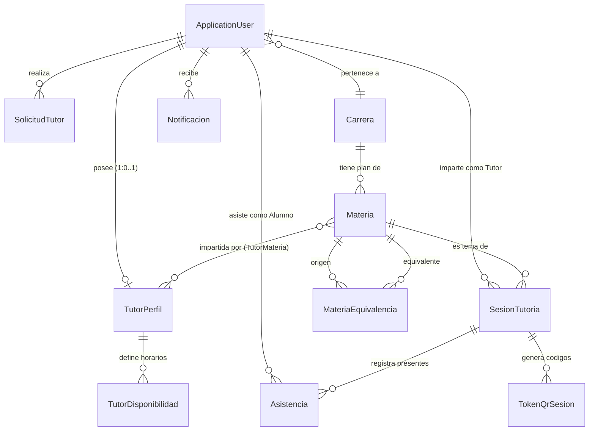

# 📊 Modelo de Datos del Sistema de Tutorías Académicas

Este documento formaliza el **Modelo Entidad-Relación y de Clases** del sistema, alineado a los requerimientos funcionales (`openspec/specs/requirements.md`) y las reglas de negocio institucionales (`openspec/specs/REQUISITOS_Y_FLUJO_SISTEMA.md`).

---

## 🏛️ 1. Visión General del Modelo

El sistema opera sobre **ASP.NET Core Identity** con Entity Framework Core (Azure SQL / SQL Server), estructurado en 6 áreas de dominio:



---

## 🗂️ 2. Módulos y Entidades Detalladas

### Módulo A: Identidad y Cuentas (RF-01 a RF-04, RF-31, RF-32)

#### `ApplicationUser` (extiende `IdentityUser`)
Representa a cualquier usuario del sistema (Alumno, Docente, Tutor o Coordinador).
* `Id` (PK, `string` GUID)
* `UserName` (`string`, igual a `Email`)
* `Email` (`string`, restringido a `@alumno.ipn.mx` o `@ipn.mx`)
* `EmailConfirmed` (`bool`, validación vía token de correo)
* `Nombre` (`string`, requerido, máx 100) — *Nombre(s) de la persona*
* `ApellidoPaterno` (`string`, requerido, máx 100) — *Primer apellido*
* `ApellidoMaterno` (`string`, requerido, máx 100) — *Segundo apellido (obligatorio)*
* `NombreCompleto` (`[NotMapped] string`, propiedad de conveniencia calculada: `$"{Nombre} {ApellidoPaterno} {ApellidoMaterno}".Trim()`)
* `Boleta` (`string`, requerido, máx 20, validado en backend: solo dígitos numéricos `^[0-9]+$`)
* `CarreraId` (FK nullable -> `Carrera.Id`, requerido para alumnos, nulo para docentes)
* `Academia` (`string?`, máx 150, campo abierto requerido para docentes/administrativos, validado en backend: solo letras y espacios `^[a-zA-ZáéíóúÁÉÍÓÚñÑüÜ\s]+$`, nulo para alumnos)
* `Semestre` (`int?`, requerido para alumnos de 1 a 12; nulo para docentes)
* `FotoUrl` (`string?`, ruta o URL de avatar)
* `TipoTutor` (`enum TipoTutor`: `Ninguno`, `AlumnoTutor`, `DocenteTutor`)
* `PerfilCompleto` (`bool`, bandera para forzar completar perfil en primer ingreso)
* `Activo` (`bool`, default `true`, soporte para baja lógica)
* `FechaBaja` (`DateTime?`)
* `MotivoBaja` (`string?`, máx 500)
* *Navegación:* `Carrera`, `PerfilTutor`, `Solicitudes`, `SesionesImpartidas`, `Asistencias`, `Notificaciones`.

> [!NOTE]
> **Estado de Implementación:**
> Aplicado exitosamente en código y base de datos mediante la migración `20261011231208_SepararNombreYApellidosUsuario`.
> Las capas actualizadas incluyen:
> 1. Entidad `Models/ApplicationUser.cs` (`Nombre`, `ApellidoPaterno`, `ApellidoMaterno`, `NombreCompleto`).
> 2. ViewModels `RegisterViewModel`, `ProfileViewModel`, `EditProfileViewModel` en `Models/ViewModels/AccountViewModels.cs`.
> 3. Lógica de negocio en `Services/UserProfileService.cs` y controlador `Controllers/AccountController.cs`.
> 4. Semillas de prueba en `Data/DbInitializer.cs`.
> 5. Vistas Razor responsivas `Views/Account/Register.cshtml` y `Views/Account/EditProfile.cshtml`.


---

### Módulo B: Catálogo Académico UPIICSA

#### `Carrera`
* `Id` (PK, `int`)
* `Nombre` (`string`, máx 100, ej. "Ingeniería en Informática")
* `Clave` (`string`, máx 20, ej. "N")
* *Navegación:* `Materias`, `Alumnos`.

#### `Materia`
* `Id` (PK, `int`)
* `Nombre` (`string`, máx 100)
* `Clave` (`string`, máx 20)
* `Semestre` (`int?`, 1 al 8/10)
* `CodigoEquivalencia` (`string?`, máx 50, agrupa equivalencias entre planes)
* `CarreraId` (FK -> `Carrera.Id`)
* *Navegación:* `Carrera`, `Sesiones`, `TutoresQueLaImparten`.

#### `MateriaEquivalencia`
* `Id` (PK, `int`)
* `MateriaOrigenId` (FK -> `Materia.Id`)
* `MateriaEquivalenteId` (FK -> `Materia.Id`)
* `EsBidireccional` (`bool`, default `true`)

---

### Módulo C: Estatus de Tutor y Perfil Académico (RF-05 a RF-12)

#### `SolicitudTutor`
* `Id` (PK, `int`)
* `UserId` (FK -> `ApplicationUser.Id`)
* `TipoTutorSolicitado` (`enum TipoTutor`: `AlumnoTutor` o `DocenteTutor`)
* `FechaSolicitud` (`DateTime`, UTC)
* `Estado` (`enum EstadoSolicitud`: `Pendiente`, `Aprobada`, `Rechazada`)
* `RespuestaCoordinacion` (`string?`, mensaje de retroalimentación)
* `FechaRespuesta` (`DateTime?`, UTC)

#### `TutorPerfil`
Perfil académico visible en el catálogo de tutorías para tutores aprobados.
* `Id` (PK, `int`)
* `UserId` (FK único -> `ApplicationUser.Id`, relación 1 a 0..1)
* `Biografia` (`string?`, máx 500)
* `SalonAsignado` (`string?`, máx 50, ej. "Edificio 2, Salón 204")
* `EsPublico` (`bool`, visibilidad en el catálogo general)
* `ReputacionPromedio` (`double`, promedio acumulado de estrellas 1.0 - 5.0)
* `TotalEvaluaciones` (`int`, conteo de encuestas respondidas)
* *Navegación:* `User`, `MateriasImpartidas`, `Disponibilidades`.

#### `TutorMateria` (Tabla intermedia N:M)
Permite al tutor seleccionar qué materias del catálogo imparte.
* `TutorPerfilId` (PK/FK -> `TutorPerfil.Id`)
* `MateriaId` (PK/FK -> `Materia.Id`)

---

### Módulo D: Disponibilidad, Sesiones y Catálogo (RF-13 a RF-17)

#### `TutorDisponibilidad` (Horarios Recurrentes)
Registra la oferta horaria semanal fija del tutor.
* `Id` (PK, `int`)
* `TutorPerfilId` (FK -> `TutorPerfil.Id`)
* `DiaSemana` (`DayOfWeek` o `enum DiaSemana`: Lunes a Sábado)
* `HoraInicio` (`TimeSpan`, ej. 14:00)
* `HoraFin` (`TimeSpan`, ej. 16:00)
* `Lugar` (`string`, máx 100, ej. "Laboratorio 3")
* `Activo` (`bool`, default `true`)

#### `SesionTutoria` (Instancia de Tutoría / Evento de Asistencia)
Representa un bloque de tutoría específico (fecha y hora concreta) donde se imparte la asesoría y se toma asistencia.
* `Id` (PK, `int`)
* `Titulo` (`string`, máx 150)
* `Descripcion` (`string?`, máx 500)
* `MateriaId` (FK -> `Materia.Id`)
* `TutorId` (FK nullable -> `ApplicationUser.Id`, null en Tutorías Especiales de Coordinación)
* `TipoTutoria` (`enum TipoTutoria`: `EntrePares`, `IndividualDocente`, `EspecialCoordinacion`)
* `FechaHoraInicio` (`DateTime`)
* `FechaHoraFin` (`DateTime`)
* `Lugar` (`string`, máx 100)
* `CapacidadMaxima` (`int`, default 10; estricto 10 para docente, configurable para pares)
* `Activa` (`bool`, default `true`)
* *Navegación:* `Materia`, `Tutor`, `Asistencias`, `TokensQr`.

---

### Módulo E: Asistencias, Tokens QR y Encuestas (RF-18 a RF-25)

#### `SesionQrToken` (Manejo de QR Dinámico TOTP / 20 min)
* `Id` (PK, `int`)
* `SesionId` (FK -> `SesionTutoria.Id`)
* `Token` (`string`, hash o token único de asistencia)
* `FechaExpiracion` (`DateTime`, UTC; exactamente 20 min tras generación)
* `FechaCreacion` (`DateTime`, UTC)
* `Activo` (`bool`, default `true`)

#### `Asistencia`
Registra la asistencia acreditada de un alumno en una sesión.
* `Id` (PK, `int`)
* `SesionId` (FK -> `SesionTutoria.Id`)
* `AlumnoId` (FK -> `ApplicationUser.Id`)
* `FechaHoraRegistro` (`DateTime`, UTC)
* `Metodo` (`enum MetodoAsistencia`: `CodigoQR`, `ManualSignalR`)
* `Confirmada` (`bool`, para método manual vía SignalR antes de consolidar)
* **Encuesta de Retroalimentación:**
  * `CalificacionEncuesta` (`int?`, rango 1 a 5 estrellas, nullable hasta responder)
  * `ComentarioEncuesta` (`string?`, máx 300)
  * `FechaEncuesta` (`DateTime?`, UTC)

---

### Módulo F: Notificaciones del Sistema (RF-26 a RF-28)

#### `Notificacion`
Bandeja de entrada in-app y registro de avisos.
* `Id` (PK, `int`)
* `UserId` (FK -> `ApplicationUser.Id`)
* `Titulo` (`string`, máx 100)
* `Mensaje` (`string`, máx 500)
* `Leida` (`bool`, default `false`)
* `FechaEnvio` (`DateTime`, UTC)
* `Tipo` (`enum TipoNotificacion`: `AprobacionTutor`, `ConfirmacionAsistencia`, `AvisoGeneral`, `EncuestaDisponible`)
* `UrlAccion` (`string?`, enlace directo a la vista relacionada)

---

## 🔗 3. Enumeraciones del Sistema

```csharp
public enum TipoTutor
{
    Ninguno = 0,
    AlumnoTutor = 1,
    DocenteTutor = 2
}

public enum EstadoSolicitud
{
    Pendiente = 0,
    Aprobada = 1,
    Rechazada = 2
}

public enum TipoTutoria
{
    EntrePares = 1,
    IndividualDocente = 2,
    EspecialCoordinacion = 3
}

public enum MetodoAsistencia
{
    CodigoQR = 1,
    ManualSignalR = 2
}

public enum TipoNotificacion
{
    General = 0,
    SolicitudTutor = 1,
    Asistencia = 2,
    Encuesta = 3
}
```

---

## 📐 4. Matriz de Cobertura con Requerimientos Funcionales

| Módulo RF | Requerimientos | Entidades Responsables |
| :--- | :--- | :--- |
| **Módulo 1: Auth & Perfiles** | RF-01 a RF-04, RF-31, RF-32 | `ApplicationUser`, `Carrera` |
| **Módulo 2: Estatus Tutores** | RF-05 a RF-08 | `SolicitudTutor`, `ApplicationUser` |
| **Módulo 3: Perfil Académico** | RF-09 a RF-12 | `TutorPerfil`, `TutorMateria`, `Materia` |
| **Módulo 4: Catálogo y Horarios** | RF-13 a RF-17 | `TutorDisponibilidad`, `SesionTutoria`, `MateriaEquivalencia` |
| **Módulo 5: Asistencia Presencial** | RF-18 a RF-23 | `SesionTutoria`, `SesionQrToken`, `Asistencia` |
| **Módulo 6: Encuestas y Reputación**| RF-24 a RF-25 | `Asistencia` (campos encuesta), `TutorPerfil` |
| **Módulo 7: Notificaciones** | RF-26 a RF-28 | `Notificacion` |
| **Módulo 8: Métricas & PDF** | RF-29 a RF-30 | Vistas/Consultas agregadas sobre `Asistencia`, `SesionTutoria` |
